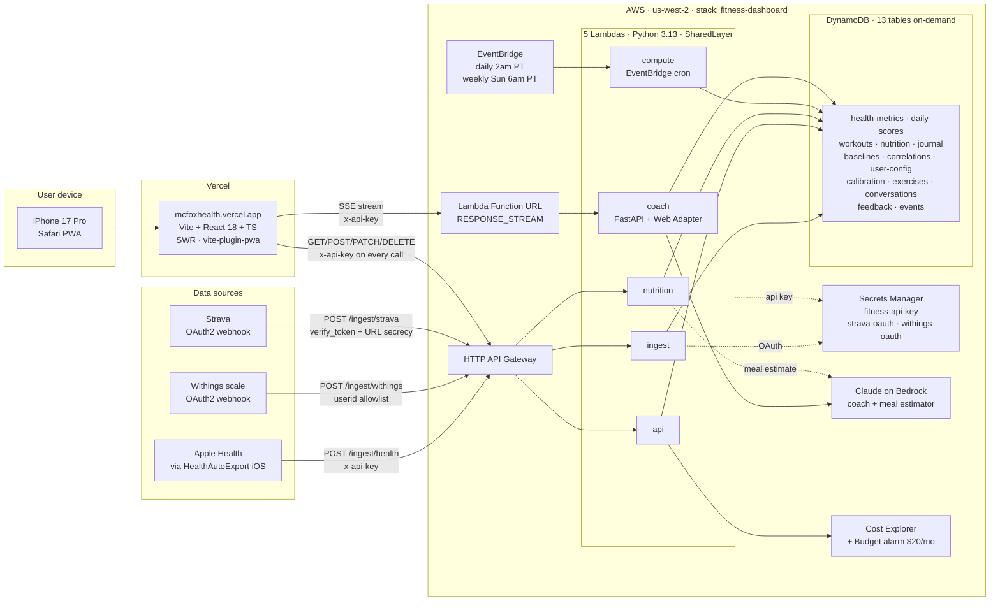

# McFox Health Tracker — Project Overview

> A complete handoff document. Written 2026-05-05. Targets a new engineer or coding assistant joining the project cold.

---

## 1. What it is

**McFox** is a personal performance dashboard for one user (Mateo, 34, San Diego). iPhone-first PWA built around three rings — **Recovery / Strain / Sleep** — calibrated against Whoop and Oura conventions. Data flows from Apple Health (via HealthAutoExport), Withings smart scale, and Strava into AWS, gets scored nightly, and surfaces back through a Vite/React PWA. An AI coach (Claude on Bedrock, streaming) reads the same data and helps with planning, debriefs, and journaling.

Not a product, not multi-tenant — single user, opinionated, owned end to end.

**Live URLs**
- Frontend: `https://mcfoxhealth.vercel.app` (Vercel, auto-deploy on push to `main`)
- API Gateway: `https://5vvp43vamk.execute-api.us-west-2.amazonaws.com` (AWS, `us-west-2`)
- Repo: `github.com/91mateot/mcfoxhealth` (private)
- SAM stack: `fitness-dashboard` in `us-west-2`

---

## 2. Architecture



Read top-to-bottom: phone + integrations push data into AWS, the React PWA reads/writes through API Gateway, the coach streams over a separate Function URL because API Gateway buffers. Compute runs nightly on a cron, never on the request path.

## 3. Stack details

### Frontend
- Vite 5 + React 18 + TypeScript (strict)
- SWR for data fetching (60s refresh on Today, on-demand elsewhere)
- `vite-plugin-pwa` → service worker, offline shell, iOS standalone install
- No CSS framework — inline styles using palette tokens from `src/theme.ts` (3 themes: Lime/Zine/Graphite)
- `DESIGN.md` is the frontend design contract; read it before UI, theming, or component work
- `@zxing/browser` for barcode scanning in LogMeal

### Backend
- AWS SAM (`backend/template.yaml`), Python 3.13 Lambdas
- HTTP API (API Gateway v2) for `/ingest/*` and `/api/*`
- Lambda Function URL (RESPONSE_STREAM) for the coach — required because API Gateway buffers
- DynamoDB (13 tables, all on-demand)
- EventBridge cron (compute Lambda)
- Secrets Manager (`fitness-api-key`, `strava-oauth`, `withings-oauth`)
- Anthropic Claude on Amazon Bedrock for the coach + meal macro estimation

### Integrations
- **Apple Health** → HealthAutoExport (HAE) iOS app pushes JSON to `/ingest/health`
- **Withings** → OAuth2 + webhook to `/ingest/withings`
- **Strava** → OAuth2 + webhook to `/ingest/strava`
- **Claude (Bedrock)** → coach Lambda, meal macro estimator

---

## 4. Repo layout

```
fitnessdashboard/
├── src/                      Frontend
│   ├── App.tsx               Tab shell
│   ├── api.ts                SWR hooks + POST helpers + track() telemetry
│   ├── theme.ts              Palette tokens
│   ├── types.ts              Shared TS types
│   ├── screens/              Today, Train, Fuel, Progress
│   ├── modals/               Chat, Journal, LogMeal, LogWorkout, RingDetail,
│   │                         MealDetail, WorkoutDetail, HydrationDetail,
│   │                         Insights, *HistorySheet
│   ├── components/           Ring, BigRing, Panel, Sheet, TabBar, Stat,
│   │                         BarRow, Sparkline, Scatterplot, WeightChart,
│   │                         Chip, BarcodeScanner, VoiceInput, ...
│   └── lib/
├── backend/
│   ├── template.yaml         SAM (5 Lambdas, 13 DynamoDB tables, 1 Layer,
│   │                         1 HTTP API, 1 Function URL, 1 Budget alarm)
│   ├── shared/
│   │   ├── shared/           Canonical shared package — bundled into a Layer
│   │   │   ├── scoring.py            Recovery/Strain/Sleep math
│   │   │   ├── sleep_quality.py      Quality flags + segment math
│   │   │   ├── coach_context.py      Snapshot the coach reads
│   │   │   ├── conversation_service.py
│   │   │   ├── nutrition_service.py
│   │   │   ├── workout_service.py
│   │   │   ├── workout_proposer.py   "Today's plan" generator
│   │   │   ├── lift_compute.py       PR/stall detection
│   │   │   ├── insight_templates.py  Plain-English insight cards
│   │   │   ├── pearson.py            Correlation math
│   │   │   ├── feedback_service.py   Thumbs up/down
│   │   │   ├── event_service.py      Telemetry write/rollup
│   │   │   ├── cost_service.py       Cost Explorer cache
│   │   │   ├── timezone.py           PT day boundary helpers
│   │   │   └── db.py                 Boto3 wrappers
│   │   └── Makefile          Build SharedLayer (uses $(MAKEFILE_LIST))
│   ├── functions/
│   │   ├── ingest/handler.py
│   │   ├── compute/handler.py
│   │   ├── api/handler.py
│   │   ├── nutrition/handler.py
│   │   └── coach/{app.py,run.sh}     FastAPI + Lambda Web Adapter
│   ├── scripts/              hae_backfill.py, oauth helpers, reestimate_meals.py
│   └── tests/                pytest (unit) + test_api_contract.py (live)
├── prototype/                Archived Babel-standalone export (Apr 2026) — DO NOT TOUCH
├── uploads/                  Reference docs (scoring guides, training notes)
├── withings-mcp/             Sibling repo (github.com/partymola/withings-mcp);
│                             MCP server for local Claude queries
├── HANDOFF.md                Older overview (some sections stale — see §11)
├── CLAUDE.md                 Repo-level context for Claude Code
├── AGENTS.md                 Codex counterpart to CLAUDE.md (uncertain origin
│                             — see §11)
├── SCORING-ALGORITHMSfromClaudeChat.md  Reference scoring doc
└── PROJECT-OVERVIEW.md       This file
```

---

## 5. The five Lambdas

### `ingest`
`POST /ingest/{health,withings,strava}` and `GET /ingest/strava` (Strava verify_token handshake).

- **HAE → `/ingest/health`** — `x-api-key` required. Auto-detects three payload shapes per metric: aggregated sleep (sums to minute fields), unaggregated sleep segments (preserved on the row), per-sample HR (routed to a `hr#hae_samples` sidecar row used later for sleep-window HR stats).
- **Withings webhook → `/ingest/withings`** — checks `userid` against an allowlist baked into the `withings-oauth` secret (keys `userid` / `user_id` / `userids`). Spoofed userids are rejected.
- **Strava webhook → `/ingest/strava`** — does **not** verify a per-POST signature (Strava doesn't send one). Security model: GET verify_token handshake at subscription time + URL secrecy + the activity is always re-fetched from Strava on every event, so a spoofed POST with an unknown id no-ops. (Earlier commits added an HMAC check; commit `37b39a0` removed it after verifying Strava doesn't send a header.)

### `compute`
EventBridge cron, no API surface.
- **Daily 2am PT (`cron(0 9 * * ? *)`)** — recompute baselines (rolling 14-day median), recovery/strain/sleep scores, sleep quality flags, planned workout for today.
- **Weekly Sunday 6am PT (`cron(0 13 ? * SUN *)`)** — Pearson correlations (intervention → outcome), event_rollup for telemetry.

### `api`
`GET /api/*` reads. Every route requires `x-api-key`.

| Path | Returns |
|------|---------|
| `/api/today` | Today dashboard: rings, journal, plan, sleep detail |
| `/api/progress` | Body comp + 30d trends + lifts + infra-cost |
| `/api/workouts` | Recent sessions |
| `/api/nutrition/{date}` | Per-day macros + meals |
| `/api/nutrition/history` | Last 7 days |
| `/api/insights` | Correlation cards |
| `/api/conversation/latest` | Most recent coach thread (6h TTL) |
| `/api/conversation/list` | Past threads |
| `/api/conversation/{id}` | Specific thread |
| `/api/journal/history` | All journal entries |
| `/api/infra-cost` | Cost Explorer summary (cached 6h) |
| `/api/calibration/reference` | Withings calibration ref |
| `/api/favorites` | Saved meals |

### `nutrition`
`POST/PATCH/DELETE /api/*` writes. All require `x-api-key`.

| Path | Method | Purpose |
|------|--------|---------|
| `/api/meal` | POST | Log meal |
| `/api/meal/estimate` | POST | Bedrock macro estimate (no log) |
| `/api/meal/{date}/{id}` | PATCH/DELETE | Edit / delete |
| `/api/favorites` | POST | Save favorite |
| `/api/favorites/{id}` | DELETE | Remove |
| `/api/water` | POST | Log water |
| `/api/water/{date}/{id}` | DELETE | Remove |
| `/api/journal` | POST | Morning/evening check-in |
| `/api/journal/prompts` | POST | Coach reflection prompts |
| `/api/journal/note` | PATCH/DELETE | Edit/remove a timestamped note |
| `/api/workout` | POST | Log workout |
| `/api/workout/{date}/{id}/annotate` | POST | Annotate sets/reps after the fact |
| `/api/workout/{date}/{id}/feedback` | POST | Plan-fit thumbs |
| `/api/calibration/reference` | POST | Save Withings reference weight |
| `/api/feedback` | POST | Coach reply thumbs |
| `/api/event` | POST | Telemetry |
| `/api/planned-workout/refresh` | POST | Force re-propose today's plan |

### `coach`
FastAPI under Lambda Web Adapter, **Function URL with `AuthType=NONE`**, RESPONSE_STREAM mode (required for SSE streaming — API Gateway HTTP API buffers and breaks streaming). App-level `x-api-key` check in a FastAPI dep. `/health` stays public for the adapter health probe. `COACH_AUTH_REQUIRED=0` bypasses for local dev.

The coach reads a `coach_context.py` snapshot and has tool access for: `log_meal`, `log_water`, `log_workout`, `delete_meal`, `annotate_workout`, `propose_recovery_day`, `list_recent`, journal prompt Q&A, and more. Resumes the latest thread automatically (6h TTL window) so picking up the chat feels continuous.

---

## 6. Auth model

- **API key** in Secrets Manager (`fitness-api-key`), with env-var fallback `INGEST_API_KEY`.
- **Frontend** reads `VITE_API_KEY` from Vercel env vars and sends `x-api-key` on every request, including the coach SSE stream. `src/api.ts::authHeaders()`.
- **HAE** sends `x-api-key`.
- **Strava** webhook is unsigned by spec — relies on (1) the GET verify_token handshake at subscription, (2) URL secrecy, (3) re-fetching the activity on each event so unknown ids fall through.
- **Withings** notification trust is enforced by the `userid` allowlist in `withings-oauth`.
- **Coach** Function URL is `AuthType=NONE` because IAM auth on Function URLs breaks RESPONSE_STREAM. The `x-api-key` check is in app code instead.

---

## 7. Scoring

Reference doc: `SCORING-ALGORITHMSfromClaudeChat.md`. Math lives in `backend/shared/shared/scoring.py`. Tests in `backend/tests/test_scoring.py`.

### Recovery (0–100)
Weighted composite of HRV, RHR, sleep, respiratory rate, SpO2, wrist temp. Default weights (40/25/20/5/5/5) are stored in `fitness-user-config` and hot-swappable.

- **Missing-signal handling (Oura convention):** a missing input redistributes its weight across the present inputs proportionally — does not zero out.
- **Sleep weighting:** when `quality_flag != ok`, sleep is treated as **missing** (not a broken-0). Truncated nights bump weight to HRV/RHR rather than tanking the score.
- **Green-day calibration:** baselines are rolling 14-day **medians** (was: means). Better tail behavior for sick days and outliers.
- Each daily score row snapshots `recovery_weights_used` + `strain_coefficient`, so retrospective scores stay reproducible across weight tuning.

### Strain (0–21)
`21 × (1 − e^(−TRIMP/300))`, where TRIMP is zone-weighted (Edwards 1993): minutes in HR zones × zone weight (1..5). Coefficient (300) is in user_config.

### Sleep (0–100)
Two ladders:
- **4-component (Oura-style)** when only aggregated data is available: duration 35 / efficiency 25 / deep 20 / REM 20.
- **5-component** when `continuity_idx` is available (segments present): 30/20/15/15/20 with continuity = "restorative vs disturbances," Bevel/Whoop-style.
- **6-component (in scoring.py)** layers HR dip on top — HR dip is the gap between sleeping HR and **today's actual** RHR (commit `345c10b`: was anchored against stale baseline; now uses actual).

### Sleep Bank
7-day exponential decay of `sleep_debt = target − actual`. Target is fixed; strain and goals don't move it. (`14ea734`)

---

## 8. Sleep pipeline

The deepest area of recent work. See `shared/sleep_quality.py`.

1. **Ingest auto-detects shape:**
   - Aggregated `{totalSleep, deep, rem, core, awake, sleepStart, sleepEnd}` → sums into minute fields.
   - Unaggregated `[{startDate, endDate, value}]` → preserved as `segments[]` on the sleep row.
   - Per-sample HR (timestamped points) → sidecar `hr#hae_samples` row.
   - Recent commits hardened against unaggregated payloads clobbering aggregated data (`19bf600`, `1d424b8`).

2. **Quality flags** — every row gets `quality_flag` ∈ {ok, partial, truncated, missing}, a `reasons[]` list, and `confidence` 0–1. Ingest does an optimistic check; compute re-checks with wrist-temp context and can downgrade.

3. **Compute derives:**
   - `arousal_count`, `onset_min`, `continuity_idx` from `segments[]`.
   - `avg_hr_sleep` and `min_hr_sleep` by intersecting `hr#hae_samples` with `sleep_start`/`sleep_end`.
   - Segments are **clustered by `sleepStart` and keyed to wake-up morning** (`7119b95`) — multi-segment nights group correctly across the midnight boundary.
   - Missing fields just stay absent; nothing fails.

4. **Frontend (`RingDetail.tsx`):** hypnogram strip when segments exist, incomplete-night badge when `quality_flag !== 'ok'`, rows for wake-ups / onset / sleeping HR. `Today.tsx` dims the sleep ring to grey on truncated nights.

5. **No manual entry.** Mateo explicitly rejected a manual-input path. Richer signals auto-activate when HAE exports unaggregated sleep + per-sample HR.

---

## 9. Telemetry + cost

- **App telemetry** — `src/api.ts::track()` batches UI events (`tab.view`, `chat.open`, `ring.open`, `*.log.open`, `fab.tap`) and POSTs to `/api/event`. Backend writes to `fitness-events` (date pk, event_id sk, 90-day TTL). Weekly Sunday 6am compute cron rolls events up into `user_config.event_rollup`.
- **Infra cost** — `GET /api/infra-cost` hits AWS Cost Explorer, filtered to this stack's services in `us-west-2` via `FITNESS_APP_SERVICES` allowlist in `shared/cost_service.py`. Cached 6h in `user_config`. Surfaced on the Progress tab.
- **Budget alarm** — `AWS::Budgets::Budget` ($20/mo default), emails `AlertEmail` parameter at 80% actual + 100% forecast, filtered to the same allowlist + region. Pass `--parameter-overrides AlertEmail=...` on deploy to enable.

---

## 10. Frontend tour

### Tabs (`src/screens/`)
- **Today** — three rings (Recovery, Strain so-far, Sleep), greeting that adapts to time of day, journal slot card (morning/evening), planned-workout card with thumbs-up/down for plan fit, supplement chips with optimistic toggle.
- **Train** — workouts grouped by day, weekly volume by muscle group, per-workout muscle-group breakdown, plan proposer (recovery / lift / cardio).
- **Fuel** — meals + macros + water + caffeine + alcohol, barcode scanner, "describe a meal" Bedrock estimate, per-ingredient breakdown, favorites.
- **Progress** — body comp (Withings), weight chart, 30-day trends, lifts (PRs / stalls), infra cost panel, steps panel.

### Modals (`src/modals/`)
Chat (streaming, photos, voice, thread browse), Journal (morning + evening + free-form notes + reflection prompts), LogMeal (barcode + describe + photo of label), LogWorkout, RingDetail (per-ring deep dive — hypnogram for sleep, etc.), MealDetail (edit / re-estimate / delete / favorite / move-to-day), WorkoutDetail (annotate sets/reps, feedback), HydrationDetail, Insights (scatterplot of intervention → outcome with confidence).

### Notable conventions
- iOS Safari is the primary surface — Add-to-Home-Screen runs the PWA. Chrome on iOS does **not** install a PWA (it's a bookmark) and serves stale bundles; documented gotcha.
- Reta (retatrutide) and back-surgery context are stored, available to the coach, but **hidden from the UI** unless explicitly asked.
- Plain-language metrics — health metrics must be explained in plain English in any UI copy or coach reply; no unexplained jargon.
- Workout proposer must **not** suggest pickleball (Mateo plays it socially). Logging pickleball still works fine.

---

## 11. Operations

### Local dev
```bash
# Frontend
npm run dev            # local dev server
npm run build          # tsc -b + vite build
npm run typecheck

# Backend (Python 3.13)
.venv/bin/python -m pytest backend/tests \
    --deselect backend/tests/test_api_contract.py
# (contract tests hit live API; deselect for offline runs)
```

### Deploy
- **Frontend** — `git push origin main` → Vercel auto-deploys in ~60s. Env: `VITE_API_BASE`, `VITE_API_KEY`, `VITE_COACH_URL` in Vercel production.
- **Backend** —
  ```bash
  cd backend
  sam build
  sam deploy --stack-name fitness-dashboard --capabilities CAPABILITY_IAM \
    --resolve-s3 --no-confirm-changeset
  ```
- **Scoring tweaks** — update `fitness-user-config` row with key `scoring`; weights hot-swap on the next compute run.

### Shared layer gotcha
SAM's `CustomMakeBuilder` runs `make` from a random temp dir. `backend/shared/Makefile` resolves source paths via `$(MAKEFILE_LIST)` — **don't use relative paths in that Makefile** or builds break (commit `b44fd2b`).

### Workflow norm
After a clean build, the standing instruction is to commit + `git push origin main` + (for backend changes) `sam deploy` without asking. Frontend redeploy is automatic via Vercel.

---

## 12. Repo state inconsistencies (read this)

A few documents in the repo are partially stale or unclear. Be aware:

- **`HANDOFF.md`** is older than `CLAUDE.md`. Its "Known gaps" section claims read endpoints have no auth — that's wrong now. `bd07782` and `dd2aab0` added `x-api-key` enforcement on every `/api/*` route, both reads and writes, and the coach Function URL too.
- **`HANDOFF.md`** says "11 DynamoDB tables." The current count is 13 (added `fitness-feedback` and `fitness-events`). `CLAUDE.md` also still says 11.
- **`AGENTS.md`** is an untracked, near-duplicate of `CLAUDE.md` with a few stale differences (claims Strava verifies HMAC — removed in `37b39a0`; renames "Claude Bedrock" to "Codex Bedrock"). Origin uncertain. Decision deferred — don't sync, delete, or symlink without asking.
- **`SCORING-ALGORITHMSfromClaudeChat.md`** is the canonical scoring reference but doesn't yet describe the 6-component sleep score or HR-dip anchoring. Source of truth for current behavior is `backend/shared/shared/scoring.py`.
- **`Health & Fitness System Architecture.pdf`** in the repo root predates the first commit (Apr 23, 2026) and shows a completely different concept (Claude Code CLI orchestrator + MCP servers + Obsidian vault outputs) that was never built. Ignore it. The Mermaid diagram in §2 of this file is the current architecture.

---

## 13. History — 80 commits, ~Apr 26 → May 4, 2026

The project moved through six labeled phases, then settled into named feature commits.

### Initial scaffold (late April 2026)
- `a121b64` Initial commit.
- `8de3c19` HANDOFF.md for Vite+AWS stack.

### Phase 1 — meal logging core
- Bedrock macro estimator, meal time precision, hydration auto-log, per-ingredient breakdown.
- Idempotent water reestimate, alcohol hydration math, caffeine tracking.
- `KNOWN_FOODS` matcher with "not the right match" rematch button.

### Phase 2 — coach tool use + streaming
- `292c039` Coach tool use, streaming, fresh snapshot.
- Duplicate-meal prevention, `delete_meal` tool, ring labels aligned to Whoop convention (Recovery / Strain / Sleep).

### Phase 3 — nav + workout logging
- `434fd42` Tab nav overhaul, workout logging, background meal validation.

### Phase 4 — lift learning
- `0192580` → `5942b09` Lift annotation, structured storage, retroactive PR/stall recompute, AI debrief on annotation.

### Phase 5 — barcode meal logging
- `f6eee93` Barcode scanner + Fuel quick-entry button.

### Phase 6 — multimodal coach
- `d333f16` Photos in Chat + photo-of-label in LogMeal.

### Reliability + quick wins
- PWA icons, USDA serving fix, LogWorkout persistence.
- Streaming/chat fixes: blank `VITE_COACH_URL` fallback, mic stays-active fix.
- Today tile: replaced sleep-tonight projection with live strain-so-far.

### Coach memory + content depth
- `6589e12` Resume-latest threads.
- `82338d8` Weight chart with readable axes.
- `1e3544d` / `855980f` Today's workout card + Lateral Chain program + 2-3 focus lifts.
- Lift proposer guardrails (no back-to-back same-group days).

### Insights + journaling
- `827ccde` Insights modal scatterplot.
- `f378b45` Confidence factors in sample size + signal strength.
- `dace6b6` Morning + evening journal slots, free-form text, coach prompts, history.
- `5b13740` Time-marked free-form journal notes (append/edit/delete).

### Backend hardening
- `b38ec07` Consolidate shared code into a Lambda Layer.
- `b44fd2b` Resolve layer source via `MAKEFILE_LIST`.
- `bd07782` + `dd2aab0` Frontend + backend `x-api-key` everywhere.
- `49a2f14` Coach Function URL also requires `x-api-key`.
- `f341092` Compute snapshots recovery weights + strain coefficient per day.
- `8aec5f2` Fix NameError in coach system prompt from unescaped braces.
- `16f23cf` Coach `PYTHONPATH` so the Lambda Adapter subprocess finds the layer.

### Cost + telemetry
- `3039418` EventsTable + `track()` helper + weekly rollup.
- `43fc452` Infra cost MTD + weekly + budget alerts.
- `560ccbe` Cost scope to `us-west-2` to exclude co-tenant regions.

### Strava + Withings security iteration
- `50f6317` First HMAC + userid-allowlist pass.
- `76b355c` Accept Withings-native `userid` key in allowlist.
- `37b39a0` Drop the bogus Strava signature check (Strava doesn't send one) + group Train sessions by day.

### Sleep pipeline rebuild (most recent push)
- `9f2dbc7` First pass — close CLAUDE.md truncation gap.
- `f3bb527` Refresh CLAUDE.md after the rebuild.
- `38c8bac` Recovery green-day calibration + median baselines.
- `078d54e` 6-component sleep score + HR dip + Sleep Bank.
- `19bf600` Capture per-sample HR sidecar + stop unaggregated sleep clobber.
- `1d424b8` Preserve sleep window across merge + segment fallback.
- `345c10b` HR dip anchors against today's actual RHR, not stale baseline.
- `7119b95` Cluster segments by sleepStart, key to wake-up morning.
- `14ea734` Sleep Bank: fixed target + strain, 7d exponential decay.

### Most recent commit on `main`
- `37b39a0` Drop bogus Strava signature check + group Train sessions by day.

`origin/main` and local `main` are in sync as of writing.

---

## 14. Known gaps / deferred

- **`test_api_contract.py`** has 4 tests that hit live endpoints. They fail without network — deselect for local runs.
- **Sleep Band 3** — Whoop-style sleep-need wired into the score + bed/wake consistency. Deferred. `compute_sleep_need` is already defined in `scoring.py` and can be layered on without touching the data model.
- **Auth model** — uses a single `x-api-key` per environment. Fine for one user; would need rework if this ever grew to multi-user.
- **Documentation drift** — see §11. `HANDOFF.md` and `CLAUDE.md` still show 11 tables (now 13). `SCORING-ALGORITHMSfromClaudeChat.md` predates the 6-component sleep score.

---

## 15. Working with the user

- **Tone** — terse, direct. Skip end-of-response summaries; the diff speaks for itself.
- **Reta + back surgery** — known to the coach, hidden from the UI unless asked.
- **Plain language** — any health metric surfaced anywhere needs a plain-English explanation. No unexplained jargon.
- **Pickleball** — workout proposer must not suggest it. Logging it works.
- **Time** — always America/Los_Angeles for "today." Never UTC for user-facing day boundaries.
- **Workflow** — after a clean build, commit + `git push origin main` + (if backend) `sam deploy` without asking.
- **iOS Chrome PWA gotcha** — Chrome's "Add to Home Screen" on iOS produces a bookmark, not a PWA. Stale bundles result. Use Safari for the install.

---

## 16. Quick orientation for a new assistant

1. Read this file.
2. Read `CLAUDE.md` for repo-level conventions.
3. Skim `SCORING-ALGORITHMSfromClaudeChat.md` for scoring intent.
4. Open `backend/shared/shared/scoring.py` — that's the source of truth for current scoring behavior.
5. Open `backend/template.yaml` to see what's actually deployed.
6. Open `src/api.ts` for the contract between frontend and backend.
7. Run `git log --oneline | head -30` to see what's been moving lately.

If asked to ship a change, the path is: edit → typecheck/test → commit → push (frontend auto-deploys) → `sam deploy` if backend changed.
